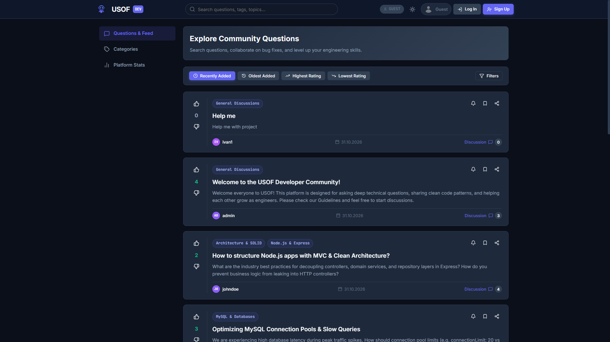
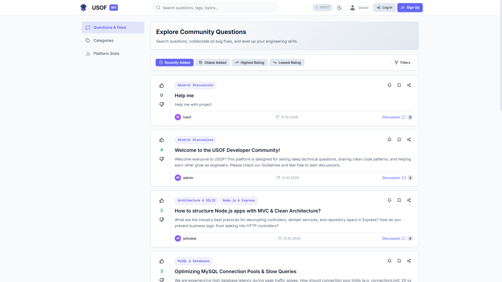
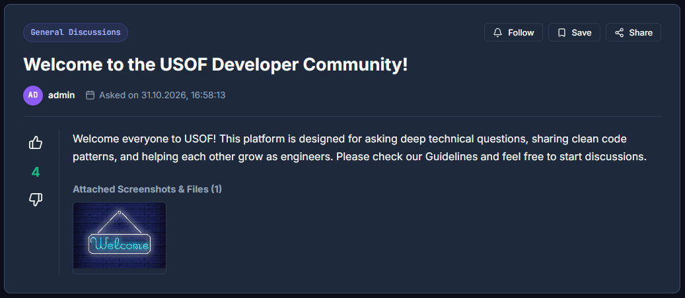
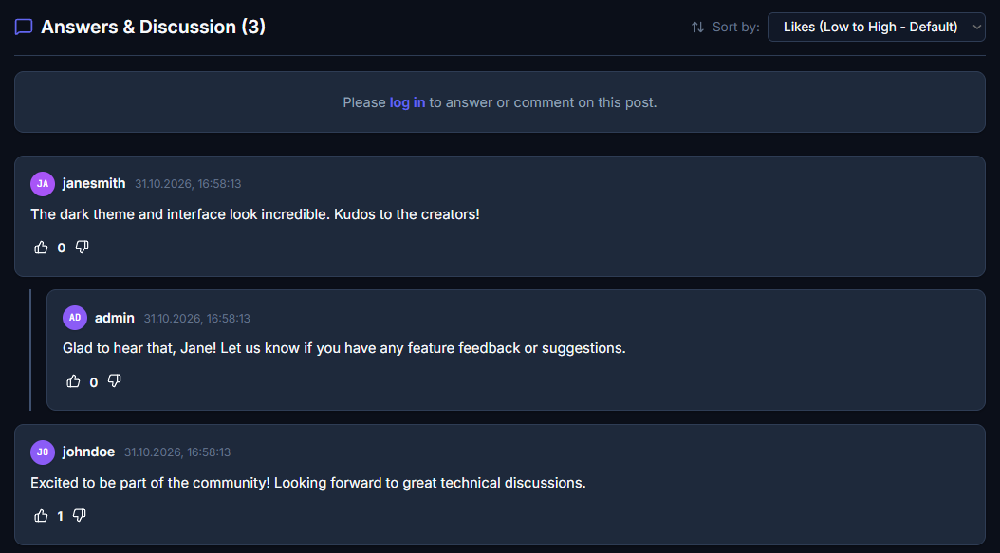
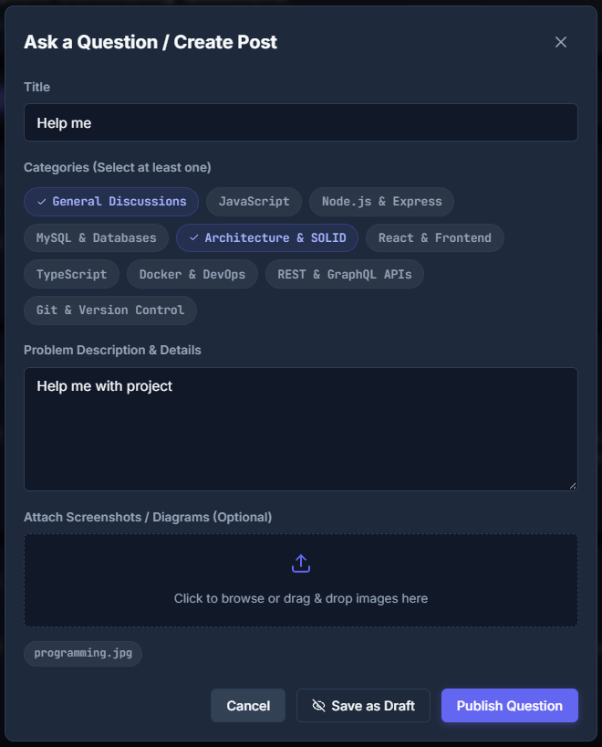
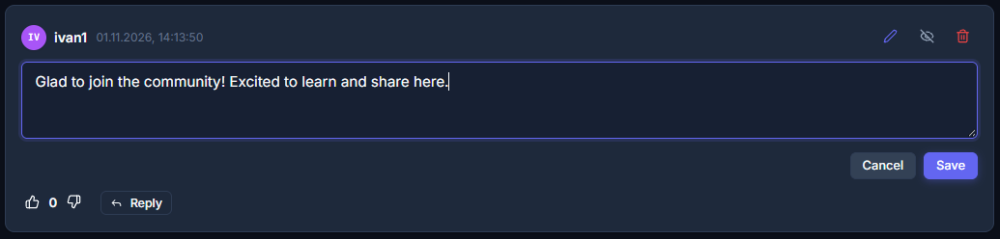
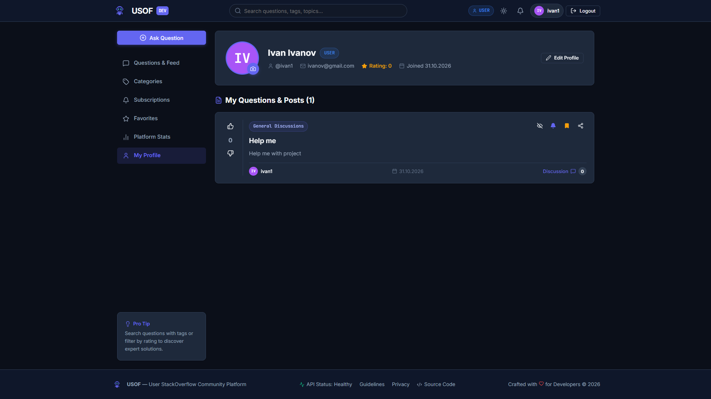
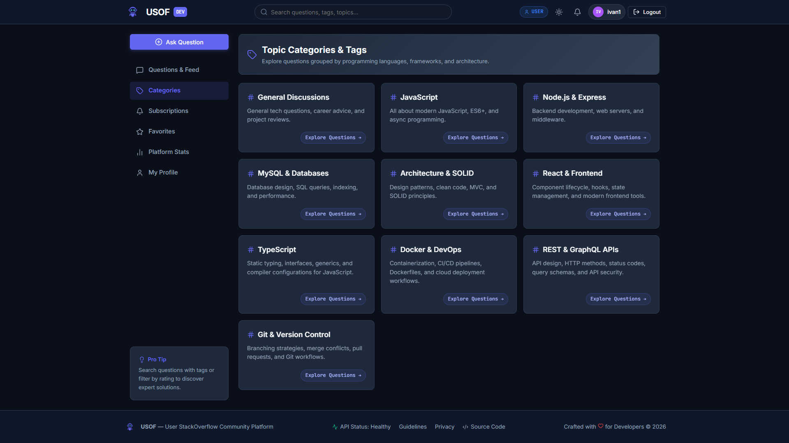
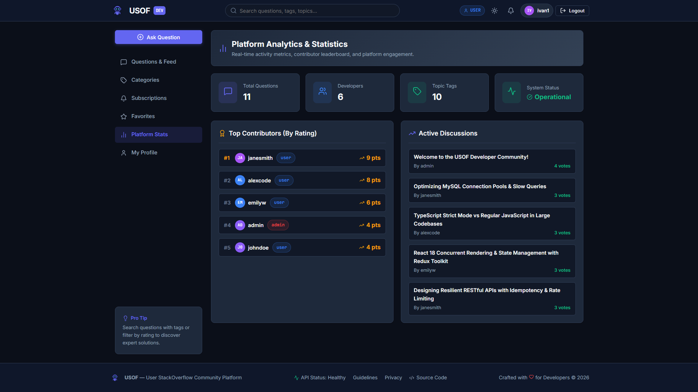
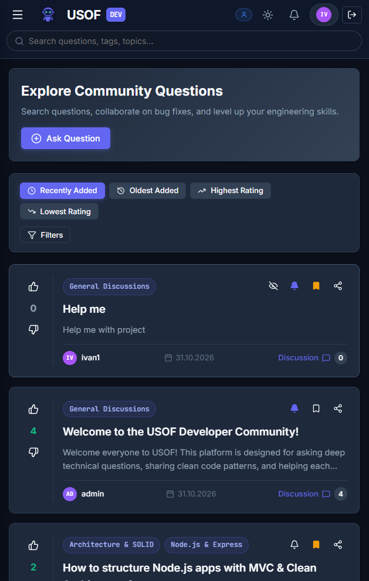

# USOF — Full-Stack Developer Q&A Platform


---

## 1. Project Overview

**USOF** (User Stack Overflow) is an enterprise-grade, modern question-and-answer platform tailored for software developers and technical teams. Inspired by Stack Overflow and engineered according to contemporary Challenge-Based Learning (CBL) standards, USOF delivers a high-performance space for asking technical questions, sharing code solutions, engaging in arbitrarily deep threaded discussions, and building developer reputation.

The platform is decoupled into two primary architectures:
1. **`web/` (Frontend Client)**: A reactive Single Page Application (SPA) built with **React 18**, **Redux Toolkit** for centralized state management, **React Router**, and a lightweight CSS design system supporting native **Dark / Light Theme** switching. It features responsive drawer navigation, threaded comment hierarchies, multi-criteria filtering, draft management, and interactive media attachments.
2. **`api/` (Backend Server)**: A robust RESTful API built on **Node.js / Express**, adhering strictly to **MVC**, **SOLID principles**, and the **Repository Pattern**. It interfaces with a normalized relational database (**MySQL 8.0**, 3NF), manages server-side sessions stored in MySQL (`express-mysql-session`), and enforces strict Role-Based Access Control (RBAC).

---

## 2. Screenshots of Solution

> [!NOTE]
> Screenshots showcase the user interface in actual operation across different workflows and screen viewports. Image files are placed in the `./screenshots/` directory.

### 2.1 Questions Feed & Developer Theme (Dark & Light Mode)
| Dark Theme Feed | Light Theme Feed |
| :---: | :---: |
|  |  |
| *Real-time question search, category tags, rating scores, and 10-item pagination* | *Instant theme switching with persistent localStorage preferences* |

---

### 2.2 Question Details & Threaded Discussion Tree
| Full Question View & Image Gallery | Threaded Nested Comments Hierarchy |
| :---: | :---: |
|  |  |
| *Technical question with attached image gallery, author details, and bookmarking* | *Arbitrary-depth recursive replies with indentation guides and vote counters* |

---

### 2.3 Creation & Management Modals
| Ask Question Modal (Multi-Image Upload) | Inline Comment Editing |
| :---: | :---: |
|  |  |
| *Tag selection, draft toggle, and multi-file drag-and-drop attachment* | *In-place comment modification reserved exclusively for original authors* |

---

### 2.4 Profile Management & Privacy Boundaries
| Member Profile (Email Protected) | Category Management (Safe Deletion) |
| :---: | :---: |
|  |  |
| *Reputation score, avatar upload, and email hidden from non-admin viewers* | *Topic catalog with automated reassignment of posts to General Discussions* |

---

### 2.5 Platform Analytics & Mobile Responsive Experience
| Real-time Analytics & Leaderboard | Mobile Off-Canvas Drawer & Search |
| :---: | :---: |
|  |  |
| *Key metric counters, top contributor rankings, and recent platform activity* | *Responsive slide-over drawer and dedicated search panel for small screens* |

---

## 3. Description of Core Algorithms & Business Logic

### 3.1 Threaded Comments Algorithm (Arbitrary-Depth Adjacency Tree)
In technical discussions, conversations naturally branch into sub-threads. USOF implements an in-memory, arbitrary-depth recursive tree generation algorithm that runs in optimal linear time:

```
Database (Flat Adjacency List)              In-Memory Tree Transformation               Recursive UI Hierarchy
┌─────────────────────────────┐             ┌─────────────────────────────┐             ┌─────────────────────────────┐
│ id: 1, parent_id: null      │             │ Comment #1 (Root)           │             │ 💬 Root Comment #1          │
│ id: 2, parent_id: 1         │    ─────►   │   └── children: [           │    ─────►   │    ├── 💬 Reply #2          │
│ id: 3, parent_id: 2         │    O(N)     │         Comment #2          │             │    │    └── 💬 Reply #3      │
│ id: 4, parent_id: 1         │             │           └── Comment #3,   │             │    └── 💬 Reply #4          │
│                             │             │         Comment #4          │             │                             │
└─────────────────────────────┘             └─────────────────────────────┘             └─────────────────────────────┘
```

1. **Relational Model**: The `comments` table stores comments with an adjacency reference: `parent_id` (a self-referential foreign key referencing `comments.id` on delete cascade). A `parent_id = NULL` signifies a root comment.
2. **Linear Transformation ($O(N)$)**:
   - When retrieving comments for a question, the SQL layer fetches all comments in a single query sorted according to user preference (by default, ascending by likes count).
   - An index hash map `Map<comment_id, CommentNode>` is initialized, attaching an empty `children: []` array to every node.
   - A single iteration links child nodes to their respective parent's `children` array:
     ```javascript
     const buildTree = (commentsList) => {
       const map = {};
       const roots = [];
       commentsList.forEach(item => { map[item.id] = { ...item, children: [] }; });
       commentsList.forEach(item => {
         if (item.parent_id && map[item.parent_id]) {
           map[item.parent_id].children.push(map[item.id]);
         } else {
           roots.push(map[item.id]);
         }
       });
       return roots;
     };
     ```
3. **Recursive Rendering**: The frontend component `CommentTree` renders each root node via `CommentItem`, which recursively renders its own `children` array with dynamic indentation, visual nesting borders (`border-left: 2px solid var(--border-color)`), and independent reply forms.

---

### 3.2 Real-Time User Rating & Reputation Algorithm
Developer reputation reflects active community contributions. The platform computes user rating dynamically using an aggregated mathematical formula:

$$\text{User Rating} = \sum (\text{Post Likes} - \text{Post Dislikes}) + \sum (\text{Comment Likes} - \text{Comment Dislikes})$$

- **Execution**: Whenever any user adds, alters, or removes a reaction (upvote/downvote) on a question or comment, the backend triggers `userRepository.recalculateRating(targetAuthorId)`.
- **Atomic SQL Implementation**:
  ```sql
  UPDATE users u
  SET rating = (
    COALESCE((SELECT COUNT(*) FROM likes l JOIN posts p ON l.target_type = 'post' AND l.target_id = p.id WHERE p.author_id = ? AND l.type = 'like'), 0)
    +
    COALESCE((SELECT COUNT(*) FROM likes l JOIN comments c ON l.target_type = 'comment' AND l.target_id = c.id WHERE c.author_id = ? AND l.type = 'like'), 0)
    -
    COALESCE((SELECT COUNT(*) FROM likes l JOIN posts p ON l.target_type = 'post' AND l.target_id = p.id WHERE p.author_id = ? AND l.type = 'dislike'), 0)
    -
    COALESCE((SELECT COUNT(*) FROM likes l JOIN comments c ON l.target_type = 'comment' AND l.target_id = c.id WHERE c.author_id = ? AND l.type = 'dislike'), 0)
  )
  WHERE u.id = ?;
  ```
- **Integrity**: Rating calculations are atomic, immune to race conditions, and update instantly on both the author's profile and the platform leaderboard (`/stats`).

---

### 3.3 Safe Category Deletion & Orphan Prevention Algorithm
To prevent questions from being left without topics when an administrator removes an obsolete or duplicated category, USOF implements a strict cascading migration algorithm:

```
[Admin requests DELETE /api/categories/:id]
                    │
                    ▼
   Is category "General Discussions"?
      ├── YES ──► ABORT: Return HTTP 400 "Protected Category"
      └── NO  ──► Proceed
                    │
                    ▼
   Locate or Auto-Create baseline category "General Discussions"
                    │
                    ▼
   Find all questions linked to deleted category
                    │
                    ▼
   For each question:
      ├── Does question already have "General Discussions"?
      │      ├── YES ──► Keep existing association
      │      └── NO  ──► Link question to "General Discussions"
      └── Remove link to the deleted category
                    │
                    ▼
   Execute atomic DELETE on target category
                    │
                    ▼
   Result: Zero Orphan Questions Guaranteed
```

1. **Root Category Protection**: The default category `General Discussions` is protected at the service layer; any deletion attempt throws an `ApiError.badRequest`.
2. **Post Reassignment**: If category `Java` (ID 3) is deleted, all posts tagged with `Java` are checked:
   - If a post is only tagged with `Java`, its tag is safely migrated to `General Discussions`.
   - If a post is tagged with `Java` and `Spring`, `Java` is unlinked while `Spring` remains intact.
3. **Database Consistency**: Guarantees referential integrity without leaving orphan records or breaking category-filtered feeds.

---

### 3.4 10-Item Page Splitting & Pagination Algorithm
To maintain optimal render performance, the platform strictly caps all post feeds to **10 questions per page**:
- **Backend Offset Math**:
  $$\text{Offset} = (\text{Page} - 1) \times 10, \quad \text{Limit} = 10$$
- **Dual Query Strategy**:
  1. `SELECT ... FROM posts ... LIMIT 10 OFFSET :offset` retrieves the active page slice.
  2. `SELECT COUNT(DISTINCT p.id) AS total FROM posts ...` computes the exact dataset size under all active filters.
  3. Total pages: `pages = Math.ceil(total / 10) || 1`.
- **Page Overflow Rule**: When an 11th question is added, it automatically splits onto Page 2.
- **Client-Side Smart Pagination Window**: For high page counts ($>7$), `Pagination.jsx` renders an ellipsis window (e.g. `1 ... 4 5 6 ... 20`) with previous/next controls, preventing UI overflow on small mobile screens.

---

## 4. Security, Validation & Best Practices

| Security Dimension | Technical Implementation & Safeguards |
| :--- | :--- |
| **Password Storage** | Passwords are cryptographic hashes produced via **`bcrypt` with 10 salt rounds**. Raw passwords are never persisted to disk or logs and cannot be recovered via dictionary or rainbow-table attacks. |
| **XSS Defense** | React’s virtual DOM escapes all dynamic values by default before rendering them to HTML. Raw `dangerouslySetInnerHTML` is prohibited across the codebase, neutralizing injected `<script>` tags or malicious HTML vectors. |
| **SQL Injection Immunity** | **100% of SQL interactions** across all repository classes (`api/repositories/`) use parameterized prepared statements (`?` placeholders) executed via `mysql2/promise`. Input parameters are never concatenated into SQL strings. |
| **Session Security** | Sessions are managed via **`express-session` backed by a persistent MySQL store (`express-mysql-session`)**. Session cookies are stamped with `httpOnly: true` (blocking unauthorized client-side JavaScript access) and `sameSite: 'lax'`. Server-side session records are destroyed on logout. |
| **Role-Based Access Control (RBAC)** | Protected endpoints use layered middleware: `isAuthenticated` verifies session state, and `checkRole('admin')` validates administrative privileges. Unauthorized requests are rejected with standardized HTTP `401 Unauthorized` or `403 Forbidden`. |
| **Data Privacy & Email Masking** | In compliance with privacy guidelines, a user's registered email address is **strictly confidential**: it is sent only to the account owner and platform administrators. For all other users and guests, the email field is scrubbed at the service layer (`email: null`). |
| **Draft Protection** | Inactive questions (drafts) are filtered at the database level (`p.status = 'active' OR p.author_id = :currentUser`). Regular users and guests cannot inspect or access another member's draft posts. |
| **Input Validation** | Every client form and backend controller validates incoming payloads: username minimum length and uniqueness, standard email format regex, password confirmation matches, non-empty question titles ($\ge 5$ characters), body content ($\ge 10$ characters), and valid image formats (`image/png`, `image/jpeg`, `image/webp`). User-friendly errors are displayed immediately. |

---

## 5. Complete REST API Reference

All backend endpoints are prefixed with `/api`. Protected endpoints require an active session cookie (`usof_sid`).

### 5.1 Authentication (`/api/auth`)
| Method | Endpoint | Access Level | Description & Parameters |
| :--- | :--- | :--- | :--- |
| `POST` | `/api/auth/register` | 🟢 Public | Register new account (`login`, `password`, `password_confirmation`, `email`, `full_name`) |
| `POST` | `/api/auth/login` | 🟢 Public | Authenticate user via username or email (`login`, `password`) |
| `POST` | `/api/auth/logout` | 🟡 Authenticated | Invalidate active session and clear session cookie |
| `GET` | `/api/auth/me` | 🟢 Public / User | Return session identity and role of current user |
| `GET` | `/api/auth/confirm-email/:confirm_token` | 🟢 Public | Verify newly registered user email address via confirmation token |
| `POST` | `/api/auth/password-reset` | 🟢 Public | Send password reset token to registered email (`email`) |
| `POST` | `/api/auth/password-reset/:confirm_token` | 🟢 Public | Reset account password using token (`password`, `password_confirmation`) |

---

### 5.2 Users & Profiles (`/api/users`)
| Method | Endpoint | Access Level | Description & Parameters |
| :--- | :--- | :--- | :--- |
| `GET` | `/api/users` | 🟢 Public | Retrieve list of registered users with ratings and roles |
| `GET` | `/api/users/:user_id` | 🟡 Authenticated | Retrieve user profile (Email exposed only to Owner or Admin) |
| `POST` | `/api/users` | 🔴 Admin Only | Create user account directly (`login`, `password`, `email`, `role`) |
| `PATCH` | `/api/users/avatar` | 🟡 Authenticated | Upload or change avatar for current logged-in user (`multipart/form-data`) |
| `PATCH` | `/api/users/:user_id/avatar` | 🟡 Owner / Admin | Upload or change avatar for specified user (Owner or Admin) |
| `PATCH` | `/api/users/:user_id` | 🟡 Owner / Admin | Update profile info (`full_name`, `login`, `email` [Owner only]) |
| `DELETE` | `/api/users/:user_id` | 🟡 Owner / Admin | Delete user account and cascade associated data |

---

### 5.3 Questions & Posts (`/api/posts`)
| Method | Endpoint | Access Level | Description & Parameters |
| :--- | :--- | :--- | :--- |
| `GET` | `/api/posts` | 🟢 Public | Get paginated list of posts (10 items/page; filters: `page`, `limit`, `sort`, `categories`, `search`, `status`) |
| `GET` | `/api/posts/:post_id` | 🟢 Public | Get single question by ID with attached media and author details |
| `GET` | `/api/posts/:post_id/categories` | 🟢 Public | Retrieve categories attached to a specific post |
| `POST` | `/api/posts` | 🟡 Authenticated | Create question (`title`, `content`, `categories`, `status`, optional `images` array max 5) |
| `PATCH` | `/api/posts/:post_id` | 🟡 Owner / Admin | Update question content, title, tags, and attached photos |
| `PATCH` | `/api/posts/:post_id/status` | 🟡 Owner / Admin | Toggle post status between `active` and `inactive` (Draft) |
| `DELETE` | `/api/posts/:post_id` | 🟡 Owner / Admin | Delete question and attached media/comments |
| `GET` | `/api/posts/:post_id/subscription` | 🟡 Authenticated | Check if current user is subscribed to post updates |
| `POST` | `/api/posts/:post_id/subscribe` | 🟡 Authenticated | Subscribe to question updates and notifications |
| `DELETE` | `/api/posts/:post_id/subscribe` | 🟡 Authenticated | Unsubscribe from question updates |

---

### 5.4 Comments & Threaded Discussions (`/api/posts/:id/comments`, `/api/comments`)
| Method | Endpoint | Access Level | Description & Parameters |
| :--- | :--- | :--- | :--- |
| `GET` | `/api/posts/:post_id/comments` | 🟢 Public | Get all comments for post (Default sorted by likes count ascending; supports `sort`) |
| `POST` | `/api/posts/:post_id/comments` | 🟡 Authenticated | Post a comment or reply (`content`, optional `parent_id` for nested replies) |
| `GET` | `/api/comments/:comment_id` | 🟢 Public | Retrieve single comment details |
| `PATCH` | `/api/comments/:comment_id` | 🟡 Owner Only | Edit own comment content (`content`). Admins cannot alter user comments |
| `DELETE` | `/api/comments/:comment_id` | 🟡 Owner / Admin | Delete comment and cascade child replies |

---

### 5.5 Reactions & Voting (`/api/posts/:id/like`, `/api/comments/:id/like`)
| Method | Endpoint | Access Level | Description & Parameters |
| :--- | :--- | :--- | :--- |
| `GET` | `/api/posts/:post_id/like` | 🟢 Public | Get like/dislike counts and current user's reaction for post |
| `POST` | `/api/posts/:post_id/like` | 🟡 Authenticated | Upvote or downvote question (`type`: `'like'` or `'dislike'`) |
| `DELETE` | `/api/posts/:post_id/like` | 🟡 Authenticated | Remove vote reaction from question |
| `GET` | `/api/comments/:comment_id/like` | 🟢 Public | Get like/dislike counts and current user's reaction for comment |
| `POST` | `/api/comments/:comment_id/like` | 🟡 Authenticated | Upvote or downvote comment (`type`: `'like'` or `'dislike'`) |
| `DELETE` | `/api/comments/:comment_id/like` | 🟡 Authenticated | Remove vote reaction from comment |

---

### 5.6 Categories (`/api/categories`)
| Method | Endpoint | Access Level | Description & Parameters |
| :--- | :--- | :--- | :--- |
| `GET` | `/api/categories` | 🟢 Public | List all technical topic categories |
| `GET` | `/api/categories/:category_id` | 🟢 Public | Get category details by ID |
| `GET` | `/api/categories/:category_id/posts` | 🟢 Public | Get all questions associated with specific category |
| `POST` | `/api/categories` | 🔴 Admin Only | Create new topic category (`title`, `description`) |
| `PATCH` | `/api/categories/:category_id` | 🔴 Admin Only | Edit category title or description |
| `DELETE` | `/api/categories/:category_id` | 🔴 Admin Only | Safely delete category with automatic post transfer to `General Discussions` |

---

### 5.7 Favorites, Subscriptions & Notifications
| Method | Endpoint | Access Level | Description & Parameters |
| :--- | :--- | :--- | :--- |
| `GET` | `/api/favorites` | 🟡 Authenticated | Get list of questions bookmarked by current user |
| `POST` | `/api/posts/:post_id/favorite` | 🟡 Authenticated | Add question to personal favorites |
| `DELETE` | `/api/posts/:post_id/favorite` | 🟡 Authenticated | Remove question from personal favorites |
| `GET` | `/api/subscriptions` | 🟡 Authenticated | Get list of followed questions with sorting and tag filtering |
| `GET` | `/api/notifications` | 🟡 Authenticated | Retrieve recent user notifications and unread counters |
| `PATCH` | `/api/notifications/:id/read` | 🟡 Authenticated | Mark specific notification as read |
| `GET` | `/api/health` | 🟢 Public | Real-time backend server uptime and health check |

---

## 6. Repository Structure

```
USOF/
├── api/                           # Backend REST API (Node.js, Express, MySQL)
│   ├── config/                    # Database connection pool (mysql2) and mailer configuration
│   ├── controllers/               # Request handling controllers (Auth, Posts, Comments, Users, etc.)
│   ├── db/                        # Schema initialization (init.js) and data seeders (seeders.js)
│   ├── middlewares/               # Authentication, RBAC, error handling, and Multer file upload
│   ├── repositories/              # Direct database abstraction layer (parameterized SQL queries)
│   ├── routes/                    # Express REST route declarations
│   ├── services/                  # Business logic services (safe deletion, notifications, etc.)
│   ├── uploads/                   # Uploaded static assets (avatars and post attachments)
│   ├── app.js                     # Express app setup, CORS, and session management
│   ├── package.json               # Backend dependencies and scripts
│   └── test_api.js                # Automated end-to-end API test verification suite
│
├── web/                           # Frontend Client (React 18 SPA + Redux Toolkit)
│   ├── public/                    # Static assets (logo.png, default avatar)
│   ├── src/
│   │   ├── api/                   # API client layer (Axios instances with interceptors)
│   │   ├── components/
│   │   │   ├── comments/          # Threaded comment hierarchy (CommentItem, CommentTree)
│   │   │   ├── common/            # Shared UI components (Avatar, Pagination, etc.)
│   │   │   ├── layout/            # Header, Sidebar, Footer, MainLayout
│   │   │   └── posts/             # PostCard, CreatePostModal, PostFilterToolbar
│   │   ├── context/               # ThemeContext (Dark/Light mode toggler)
│   │   ├── pages/                 # Full-page views (Feed, Post Details, Profiles, etc.)
│   │   ├── store/                 # Redux Toolkit store slices
│   │   ├── styles/                # Modular CSS stylesheets (theme.css, global.css, layout.css)
│   │   ├── App.jsx                # Client-side router configuration
│   │   └── main.jsx               # Application entry point
│   ├── index.html
│   ├── package.json               # Frontend dependencies and Vite build scripts
│   └── vite.config.js             # Dev server proxy configuration (/api and /uploads)
│
├── screenshots/                   # Solution screenshots directory for peer review
├── package.json                   # Root manifest for concurrent workspace execution
└── README.md                      # Comprehensive project documentation
```

---

## 7. How to Run Locally

### Prerequisites
- **Node.js**: `v18.0.0` or newer (recommended `v20.x` or `v22.x LTS`).
- **npm**: `v9.x` or higher.
- **MySQL Server**: `v8.0` running locally on port `3306`.

---

### Step 1. Clone the Repository
```bash
git clone <repository_url>
cd USOF
```

---

### Step 2. Install Dependencies
Install packages across root, backend, and frontend:
```bash
# Install root orchestration tools
npm install

# Install backend dependencies
cd api && npm install && cd ..

# Install frontend dependencies
cd web && npm install && cd ..
```

---

### Step 3. Configure Environment Variables
Create a `.env` file in the `api/` directory:
```bash
cp api/.env.example api/.env
```

Configure your local MySQL credentials in `api/.env`:
```env
PORT=3000
SESSION_SECRET=usof_super_secret_key_2026

DB_HOST=localhost
DB_PORT=3306
DB_USER=root
DB_PASSWORD=your_mysql_password
DB_NAME=usof_db
```

---

### Step 4. Initialize and Seed Database
Execute the automated migration and seeding scripts to generate normalized tables and populate diverse mock data (5 users, 10 diverse questions, categories, comments, and likes):
```bash
# Create all MySQL tables, indexes, and foreign keys
npm run db:init

# Populate database with realistic test records
npm run db:seed
```

---

### Step 5. Run the Project Concurrently
Launch both backend and frontend servers with a single command from the project root:
```bash
npm run dev
```

- 🌐 **Frontend Web Client**: [http://localhost:5173](http://localhost:5173)
- ⚙️ **Backend REST API**: [http://localhost:3000](http://localhost:3000)
- 🩺 **Health Check**: [http://localhost:3000/api/health](http://localhost:3000/api/health)

---

### Step 6. Automated Testing (API Verification)
Execute the end-to-end API test verification suite:
```bash
npm run test:api
```

---

## 8. Frontend Routes Catalog

| Route | Access Level | Description |
| :--- | :--- | :--- |
| `/` | 🟢 Public | Questions Feed: dual sorting, multi-category filters, 10-item pagination |
| `/posts/:id` | 🟢 Public | Full question view, attached image gallery, threaded comments, voting |
| `/categories` | 🟢 Public | Topic tags directory with question discovery (Admin: create & safe delete) |
| `/stats` | 🟢 Public | Platform analytics dashboard, contributor leaderboard, and platform metrics |
| `/guidelines` | 🟢 Public | Community conduct rules and technical question quality standards |
| `/privacy` | 🟢 Public | User data privacy declaration |
| `/status`, `/health` | 🟢 Public | Live API system health check page |
| `/login` | 🟢 Guests Only | Authentication view (login via username or email) |
| `/register` | 🟢 Guests Only | Account registration with format validation and email verification |
| `/password-reset` | 🟢 Guests Only | Password recovery request and token-based reset form |
| `/profile` | 🟡 Authenticated | Personal dashboard: update avatar, edit name/login/email, manage personal questions |
| `/users/:id` | 🟡 Authenticated | Public profile view of other community members (Email hidden; Admin can edit user info) |
| `/favorites` | 🟡 Authenticated | Curated collection of bookmarked questions with filtering and sorting |
| `/subscriptions` | 🟡 Authenticated | List of followed questions with real-time update notifications and filters |
| `*` | 🟢 Public | Custom branded 404 page with navigation shortcuts |

---

## 9. Pre-seeded Test Accounts

All test accounts share the same password: **`password123`**.

| Login | Password | Role | Permissions & Purpose |
| :--- | :--- | :--- | :--- |
| **`admin`** | `password123` | **Administrator** | Full administrative rights: manage categories, edit user profiles/avatars, toggle question statuses, view user emails |
| **`johndoe`** | `password123` | **User** | Author of active questions, discussions, and favorite collections |
| **`janesmith`** | `password123` | **User** | Active community member, commenter, and question subscriber |
| **`alexcode`** | `password123` | **User** | Technical contributor focused on architecture and database questions |
| **`emilyw`** | `password123` | **User** | Frontend and design-oriented contributor |

---
